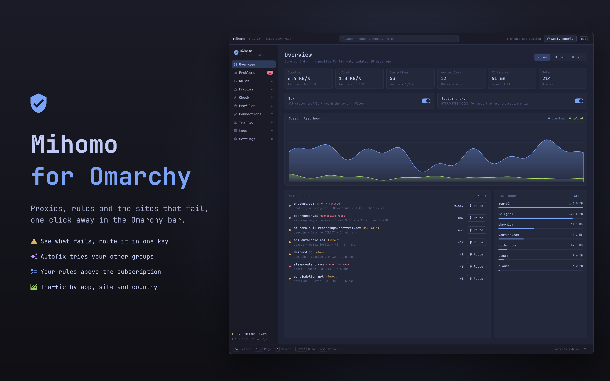
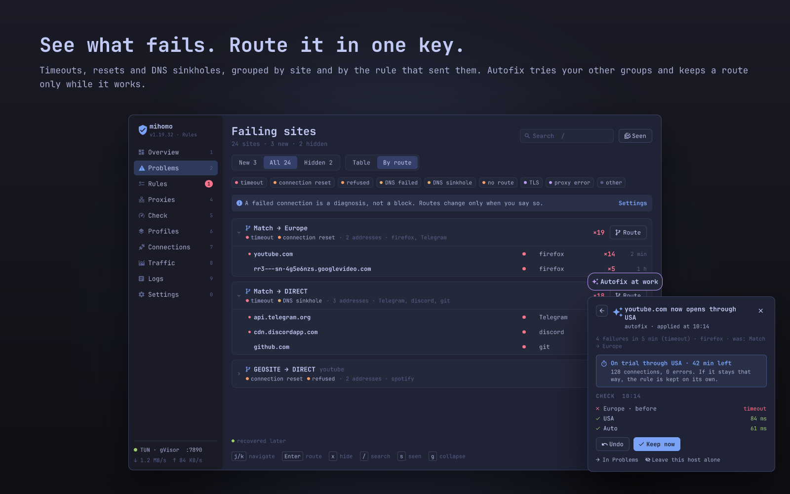
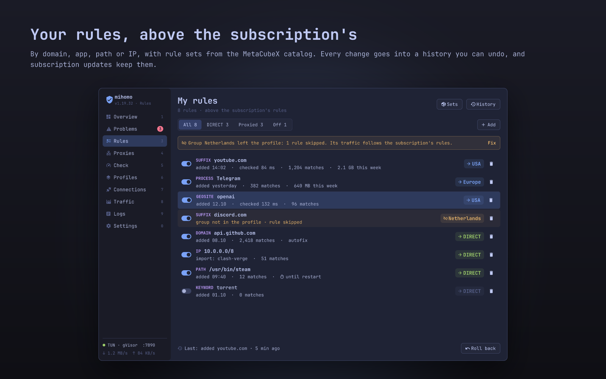
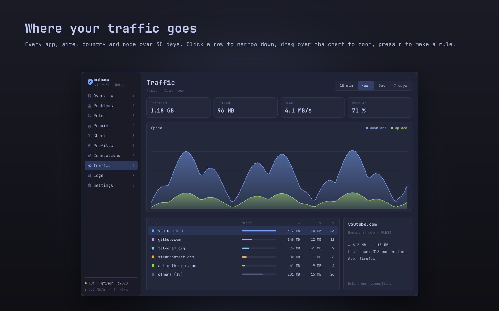
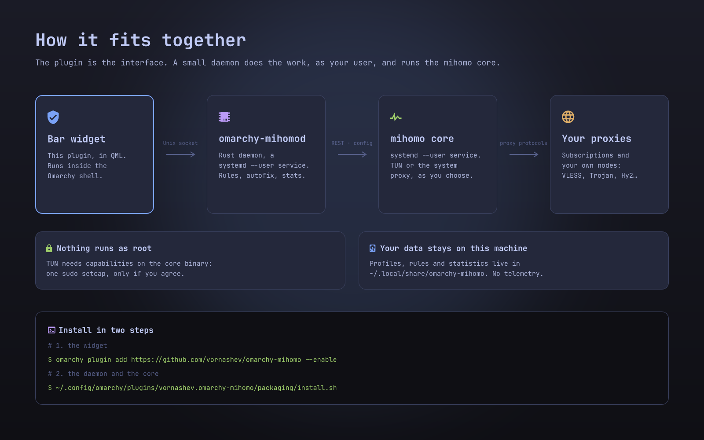

# Mihomo for Omarchy

A [mihomo](https://github.com/MetaCubeX/mihomo) control panel in the Omarchy bar: profiles and subscriptions, proxy groups, your own routing rules, the sites that fail and a way to route them, traffic by app and country, DNS and core updates. It works in English and Russian.



## What it does

- **Shows what fails.** Connections that time out, get reset or hit a DNS sinkhole are grouped by site and by the rule that sent them. One key opens a route editor for the site.
- **Fixes what nobody routed.** Autofix tries a failing site through your other proxy groups and puts the working route on trial as a temporary rule, kept only while it keeps working. Sites your rules or the subscription already send somewhere, and strict groups such as a work VPN, are left alone. Settings → Automation switches it to only showing or suggesting, or off.
- **Your rules on top of the subscription.** Rules by domain, app, path or IP, rule sets from the MetaCubeX catalog, a history with undo. Subscription updates keep them.
- **Proxies and profiles.** Group cards with health and latency history, node editors for every protocol mihomo supports, import from links or YAML, several subscriptions.
- **Traffic.** How much each app, site, country and node moved over 30 days, with alerts for unusual spikes.
- **The rest.** DNS over the profile's own, live connections and logs, core updates with rollback, a backup of the whole setup in one file.

| Problems and routes | Rules | Traffic |
|---|---|---|
|  |  |  |

## How it fits together



The plugin is only the interface. The work is done by `omarchy-mihomod`, a small Rust daemon that runs as your user, and by the mihomo core it starts. **Adding the plugin alone is not enough: install the daemon too** (step 2 below). Without it the widget shows “daemon is not running”.

## Install

Requirements: Omarchy with the Quattro shell, and either the Rust toolchain (`rustup` or `cargo`; the first build takes a few minutes) or the Arch package below.

1. Add the plugin from the marketplace, or with:

   ```sh
   omarchy plugin add https://github.com/vornashev/omarchy-mihomo --enable
   ```

2. Install the daemon and the core from that folder:

   ```sh
   ~/.config/omarchy/plugins/vornashev.omarchy-mihomo/packaging/install.sh
   ```

   It builds `omm` and `omarchy-mihomod` into `~/.local/bin` (the build goes to `~/.cache/omarchy-mihomo`), installs two user services, downloads the pinned mihomo release and checks its SHA-256. TUN mode needs network capabilities on the core, so it asks whether to run `sudo setcap` once; answer no and everything except TUN still works.

3. Click the shield in the bar, open Profiles and add a subscription link or a YAML file.

Coming from Clash Verge Rev: `omm migrate cvr` imports its profiles, closes it, takes it out of autostart, switches off its system service (with `sudo`) and starts this core instead; `omm migrate cvr --undo` brings it back.

### Other ways to install

- **Arch package:** `cd packaging/arch && makepkg -si`, then run `omarchy-mihomo-setup` once as your user. Binaries go to `/usr/bin`, services to `/usr/lib/systemd/user`. A plugin added from the marketplace is kept; otherwise the package's copy is linked in.
- **From a clone:** `packaging/install.sh` in the repository does steps 1 and 2 at once.

## Update

```sh
omarchy plugin update vornashev.omarchy-mihomo
~/.config/omarchy/plugins/vornashev.omarchy-mihomo/packaging/install.sh
```

The first command updates the widget, the second rebuilds the daemon to match. Core updates are offered in Settings → Core and are never installed on their own.

## Remove

```sh
~/.config/omarchy/plugins/vornashev.omarchy-mihomo/packaging/install.sh --uninstall
```

This stops and removes the services, the binaries, the core and the plugin. Your profiles, rules and statistics stay in `~/.local/share/omarchy-mihomo`; add `--purge` to delete them as well. To remove only the widget: `omarchy plugin remove vornashev.omarchy-mihomo`.

## Configure

The widget's own settings (Omarchy bar settings, or Settings → Main in the panel):

| Setting | Values | Default |
|---|---|---|
| Language | `auto` (system), `en`, `ru` | `auto` |
| Left click opens | `compact`, `normal`, `large` | `normal` |
| Right click opens | `compact`, `normal`, `large` | `large` |
| New-problems badge | `on`, `off` | `on` |
| Daemon socket | path, empty for the default | empty |

Everything else (automation, notifications, DNS, core) lives in the panel's Settings and is stored by the daemon. A rule for the focused window's program can be bound to a key in `~/.config/hypr/bindings.conf`:

```
bindd = SUPER ALT, P, Mihomo rule for window, exec, omm rule-for-window
```

## What it touches

The plugin runs inside the Omarchy shell without a sandbox, like every Omarchy plugin. In detail:

- **Files:** `~/.local/bin/{omm,omarchy-mihomod}`, `~/.config/systemd/user/omarchy-mihomo{d,-core}.service`, the core in `~/.local/lib/omarchy-mihomo`, data in `~/.local/share/omarchy-mihomo`, the build cache in `~/.cache/omarchy-mihomo`. The installer adds the widget to the bar with `omarchy plugin enable`; it changes no other configuration.
- **Privileges:** none by default. For TUN, `sudo setcap cap_net_admin,cap_net_bind_service,cap_net_raw=ep` on the core binary, only when you agree. Fixes that need root (the same `setcap` after a core update, `omm migrate cvr`) open a terminal where `sudo` asks.
- **Services:** two `systemd --user` units, the daemon and the core. Nothing runs as root.
- **Network:** besides your own proxies, GitHub (core releases, once a day a check for a newer one), your subscription URLs, rule sets you add and the MetaCubeX `country.mmdb` once. No telemetry.
- **System proxy:** only when you turn it on in the panel; it is put back when you turn it off or the daemon stops.

## More

- [How each part works](docs/features.md): autofix, rule sets, DNS, traffic statistics, sleep handling, backups.
- [macOS app](docs/macos.md): the same daemon behind a native SwiftUI app.
- [Development](docs/development.md): tests, lint and the QML dev loop.

## License

[MIT](LICENSE) © vornashev
